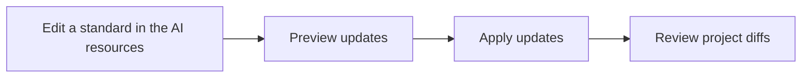

# Markdown

Source: [the AI resources](https://github.com/poziel/ai-resources).

Write documentation that is easy to understand and maintain. Choose the structure that makes the explanation easiest to follow. These conventions apply to Markdown and to the prose in MDX files.

## Lines and whitespace

Markdown prose has no fixed line length. Do not insert line breaks merely to meet a character count. Group related sentences into paragraphs and start a new paragraph when the topic or purpose changes; a sentence ending does not by itself require a paragraph break. Configure Prettier with `proseWrap: "never"` to avoid fixed-width prose wrapping. Preserve meaningful paragraph breaks, explicit hard breaks, and structural line breaks in tables, lists, and fenced blocks. Code examples and diagrams keep their own language's formatting conventions. Use UTF-8, LF line endings, and a final newline.

## Practical examples

Include concrete examples when they help explain a rule, API, configuration, command, or expected outcome. Give the reader enough context to use the example correctly, including prerequisites and important side effects, and keep it consistent with the implementation. For example, the commands below are run from a checkout of [the AI resources](https://github.com/poziel/ai-resources): the first previews which project copies would change without writing files, and the second applies those updates after review. Applying updates replaces the selected copies with the originals from [the AI resources](https://github.com/poziel/ai-resources), including any local edits to those copies.

```powershell
# Preview the changes before applying them.
./scripts/Sync-CodingStandards.ps1

# Apply the reviewed updates.
./scripts/Sync-CodingStandards.ps1 -Apply
```

## UML and Mermaid diagrams

Use UML and Mermaid diagrams freely when they visually explain structure, relationships, interactions, state changes, or workflows. Choose a diagram that fits the explanation, such as a flowchart for a process, a sequence diagram for interactions, or a class diagram for type relationships. Prefer text-based Mermaid diagrams when the destination supports them, so diagrams can be reviewed and updated alongside the document. Use fenced `mermaid` blocks with clear labels and enough context to distinguish current behavior from a proposal. This flowchart shows how shared standards reach consuming projects:



Check diagrams in the intended documentation viewer and keep them consistent with the documented behavior. Where Mermaid is unsupported, provide a supported diagram or export with a textual explanation. Refer to the [Mermaid documentation](https://mermaid.js.org/intro/) for diagram types and syntax.
